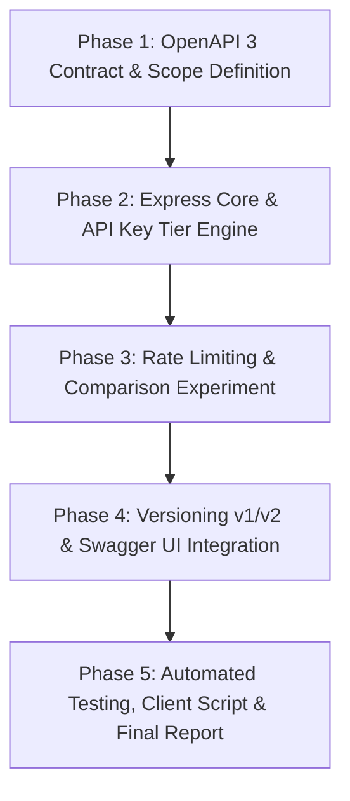

# ROADMAP: DevPulse Public API Product

**Independent Software House Data Service**  
**Milestone:** v1.0.0 — Portfolio-Grade Specialist Deliverable

---

## Phase Overview

---

### Phase 1: Contract-First Design & OpenAPI 3 Specification
- **Focus:** Write the complete OpenAPI 3.0 specification before any backend implementation.
- **Key Deliverables:**
  - `openapi.yaml`: Comprehensive schema specification for 5 endpoints across v1 and v2.
  - Definition of security schemes (`ApiKeyAuth`), tier quotas, error envelopes, and realistic examples.
- **Criteria for Done:** Valid OpenAPI 3.0 schema passes linter/validator with zero syntax errors.

---

### Phase 2: Express Server Core & Tiered Authentication
- **Focus:** Scaffold production Express application with tiered API key authentication.
- **Key Deliverables:**
  - Project setup (`package.json`, Express, cors, dotenv).
  - API Key registry simulating customer accounts across 3 tiers (Free, Developer, Enterprise).
  - Authentication middleware (`x-api-key` validation, tenant resolution, HTTP 401 handling).
  - Controller handlers implementing the 5 core endpoints.
- **Criteria for Done:** Unauthenticated calls receive 401; authenticated calls with valid keys return valid data.

---

### Phase 3: Rate Limiting Engine & Comparative Analysis (Special Constraint)
- **Focus:** Implement multi-tenant rate limiting and benchmark two alternative approaches.
- **Key Deliverables:**
  - **Approach A:** In-Memory Fixed Window Counter algorithm.
  - **Approach B:** In-Memory Sliding Window Counter algorithm.
  - Rate limiting middleware injecting `X-RateLimit-Limit`, `X-RateLimit-Remaining`, `X-RateLimit-Reset`, and `Retry-After` on HTTP `429`.
  - Configurable toggle between the two algorithms to allow empirical side-by-side benchmarking.
- **Criteria for Done:** Rate limit fires reliably at tier boundaries; comparative empirical data gathered.

---

### Phase 4: Versioning Lifecycle (v1 Deprecation & v2 Overhaul) & Swagger UI
- **Focus:** Implement multi-version routing and interactive documentation portal.
- **Key Deliverables:**
  - `/api/v1` routes with RFC-compliant `Deprecation: true`, `Sunset`, and `Link` successor headers.
  - `/api/v2` routes introducing breaking changes (standardized response envelope, ISO-8601 formatting, nested metrics).
  - Interactive Swagger UI mounted at `/docs` serving the OpenAPI spec.
- **Criteria for Done:** Documentation page is interactive and usable; v1 and v2 provide expected header differences.

---

### Phase 5: Verification, Load Testing, Client Script & Professional Reporting
- **Focus:** Empirical testing, load validation, client script, and comprehensive portfolio documentation.
- **Key Deliverables:**
  - Standalone 20-line client script demonstrating API consumption.
  - Automated load-testing verification script generating bursts and capturing 429 transitions with `Retry-After`.
  - Professional `README.md` containing business context, architecture diagram, benchmark tables, problems found & fixed, limitations, and future improvements.
  - Screen recording video walkthrough script and talking points.
- **Criteria for Done:** All 12 step-by-step instructions from assignment guidelines verified and documented.
